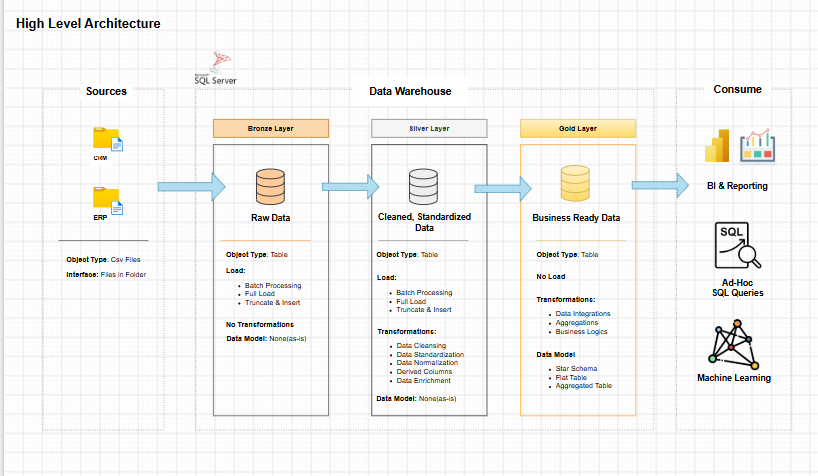

# SQL Server Data Warehouse

A SQL Server data warehouse that integrates CRM and ERP data into a centralised, analytics-ready environment using the Medallion Architecture.

## Project Overview

This project implements an end-to-end data pipeline that transforms raw sales-related data from multiple source systems into structured data for analytical reporting.

Using SQL Server and T-SQL, the warehouse ingests six CRM and ERP source tables, applies data cleansing and standardisation, and integrates customer, product, and sales information into a Gold-layer star schema.

The project demonstrates practical implementation of data ingestion, ETL workflows, data quality validation, and dimensional modelling.

## Architecture

The warehouse follows the Medallion Architecture:

- **Bronze:** Loads raw CRM and ERP data from CSV files into SQL Server.
- **Silver:** Cleans, standardises, and transforms data to improve consistency and usability.
- **Gold:** Integrates the transformed data into customer and product dimensions and a sales fact view for analytical queries.

## Business Value

By consolidating customer, product, and sales data from multiple source systems, this warehouse provides a more consistent foundation for business analysis.

It can help businesses:

- **Understand sales performance:** Analyse sales amounts, quantities, and order trends across products and customers.
- **Identify customer trends:** Explore customer demographics, locations, and purchasing activity to better understand customer segments.
- **Evaluate product performance:** Compare sales across product categories and product lines to support product and inventory decisions.
- **Support data-driven decisions:** Provide structured, integrated data for reporting and business intelligence.

By improving data consistency and making related information easier to query, the warehouse can reduce the effort required to prepare data for analysis.

## Technologies

- Microsoft SQL Server
- SQL Server Management Studio (SSMS)
- T-SQL
- Stored Procedures and Views
- Bulk Data Loading
- Data Cleansing and Transformation
- Data Quality Testing
- Dimensional Modelling and Star Schema

## Key Features

- Integrated six CRM and ERP source tables into a centralised warehouse.
- Implemented stored procedures to orchestrate Bronze and Silver layer loading.
- Applied deduplication, data standardisation, validation, and derived-column transformations.
- Developed Gold-layer customer and product dimensions and a sales fact view.
- Implemented data quality checks for data consistency and relationships between fact and dimension data.

## Gold Data Model

The Gold layer uses a star schema with three views:

- **`gold.fact_sales`** — sales transactions, order dates, quantities, prices, and sales amounts.
- **`gold.dim_customers`** — customer details, location, demographic attributes, and creation date.
- **`gold.dim_products`** — product details, categories, costs, and product-line information.

This model supports analysis of sales across customers and products.

## Repository Structure

| Directory | Description |
|---|---|
| `dataset/` | Source CSV files |
| `docs/` | Architecture diagrams, data flow models, integration model, and data catalog |
| `scripts/` | Database setup, table definitions, loading procedures, transformations, and Gold views |
| `tests/` | Silver and Gold data quality checks |

## Getting Started

1. Clone this repository.
2. Open SQL Server Management Studio and connect to your SQL Server instance.
3. Execute the database initialisation script in `scripts/`.
4. Configure the source file paths in the Bronze loading scripts for your local environment.
5. Run the Bronze and Silver loading procedures in sequence.
6. Create or update the Gold views and run the data quality checks.

Refer to the [Technical Documentation](./docs/technical_documentation.md) for implementation details and execution guidance.

## Connect

[GitHub](https://github.com/seriki-o) · [LinkedIn](https://www.linkedin.com/in/oreoluwa-seriki-51a30424a/)
